# 🏠 House Price Prediction: Regression with Supervised Learning


An end-to-end machine learning project that predicts house sale prices on the **Ames Housing dataset**. It covers theory notes, exploratory data analysis, missing-value handling, outlier removal, feature engineering, a leak-safe preprocessing pipeline, five regression models, cross-validation, hyperparameter tuning, residual analysis, feature importance, and a reusable training script that saves a production-ready pipeline.
---

## 🎥 Video Explanation

> 📌 **Video link:** https://drive.google.com/file/d/1Tu6fl43XpB1LFms7TYvwQPd6fScaJOjT/view?usp=sharing

---

## ⚡ Project at a Glance

| | |
|---|---|
| **Problem type** | Supervised regression |
| **Target** | `SalePrice` (USD), modelled as `log1p(SalePrice)` |
| **Rows / features** | 1,460 houses × 79 features (1,458 rows after outlier removal) |
| **Features after preprocessing** | 190 |
| **Models compared** | Linear Regression, Ridge, Lasso, Random Forest, XGBoost (+ tuned XGBoost) |
| **Best model** | **XGBoost** with RMSE ≈ $19,187, MAE ≈ $13,822, R² ≈ 0.933 |
| **Validation** | 80/20 split, 5-fold CV, residual analysis |
| **Deliverables** | Notebook, training script, saved model, metrics JSON, summary report |

---

## 💼 Business Problem
A PropTech startup (similar to NoBroker or MagicBricks) wants an automated estimator so buyers and sellers can benchmark property values. This project builds a model that predicts a house's sale price from its physical characteristics, quality ratings, location and sale details, and explains which factors drive the price most.

---

## 📊 Dataset
- **Source:** [Ames Housing – Kaggle](https://www.kaggle.com/c/house-prices-advanced-regression-techniques) (`train.csv`)
- **Size:** 1,460 rows, 81 columns (79 features + `Id` + `SalePrice`)
- **Feature types:** 38 numeric (including `Id` and `SalePrice`) and 43 categorical columns

| Group | Example columns |
|---|---|
| **Size & layout** | `GrLivArea`, `TotalBsmtSF`, `1stFlrSF`, `2ndFlrSF`, `LotArea`, `TotRmsAbvGrd`, `BedroomAbvGr` |
| **Quality & condition** | `OverallQual`, `OverallCond`, `ExterQual`, `KitchenQual`, `BsmtQual`, `HeatingQC` |
| **Age** | `YearBuilt`, `YearRemodAdd`, `GarageYrBlt`, `YrSold` |
| **Location** | `Neighborhood`, `MSZoning`, `Condition1`, `Condition2` |
| **Amenities** | `GarageCars`, `GarageArea`, `Fireplaces`, `CentralAir`, `PoolArea`, `Fence` |
| **Building type** | `BldgType`, `HouseStyle`, `Foundation`, `RoofStyle`, `Exterior1st` |
| **Sale details** | `SaleType`, `SaleCondition`, `MoSold`, `YrSold` |

> Place `train.csv` inside the `Dataset/` folder before running the project.

---

## 📁 Project Structure
```
Final_PR/
├── Dataset/
│   └── train.csv                  # Ames Housing data
├── Notebook/
│   └── HousePrice_SupervisedLearning.ipynb   # Theory, EDA, modelling, evaluation
├── Screenshots/                   # Plots used in this README
├── model/
│   ├── house_price_model.pkl      # Saved sklearn pipeline (created by train_model.py)
│   └── metrics.json               # Test-set metrics (created by train_model.py)
├── requirements.txt
├── summary_report.md              # Short business-style report
├── train_model.py                 # Reproducible training script
└── README.md
```

---

## 🔄 Workflow

```mermaid
flowchart LR
    A[Load train.csv] --> B[EDA & theory notes]
    B --> C[Missing values]
    C --> D[Outlier removal]
    D --> E[Feature engineering]
    E --> F[Encoding & scaling<br/>ColumnTransformer]
    F --> G[80/20 split]
    G --> H[Linear / Ridge / Lasso<br/>Random Forest / XGBoost]
    H --> I[5-fold CV &<br/>hyperparameter tuning]
    I --> J[Residual analysis &<br/>feature importance]
    J --> K[Save pipeline<br/>train_model.py]
```



---

## 📚 Theory Notes
The notebook opens with short notes on the concepts used in the project:

- **Regression vs classification:** regression predicts a continuous value (price, EMI amount, crop yield), classification predicts a category (spam / not spam, loan approved / rejected).
- **Simple vs multiple vs regularised regression:** one feature, many features, and many features with a penalty on large coefficients.
- **Ridge (L2) vs Lasso (L1):** Ridge shrinks coefficients smoothly towards zero; Lasso can set some exactly to zero, so it also performs feature selection.
- **Overfitting vs underfitting:** overfitting means low training error but high test error (high variance); underfitting means both are high (high bias). Regularisation reduces overfitting by simplifying the model.

---

## 🔍 Exploratory Data Analysis

### 1. Target variable: `SalePrice`
`SalePrice` is strongly right-skewed: most houses sell between roughly $100k and $250k, with a long tail of expensive homes up to about $750k. The Q-Q plot bends sharply away from the line at the upper end. Applying `log1p` makes the distribution close to normal, which suits linear models and stabilises errors across price ranges.

| Original (skewed) | After `log1p` (near-normal) |
|:---:|:---:|
|  |  |
|  |  |

### 2. Univariate analysis: numerical features
Many numeric features are heavily skewed or zero-inflated (a house either has a pool, porch or second floor, or it does not). The most skewed columns are `MiscVal` (skew ≈ 24.5), `PoolArea` (≈ 14.8), `LotArea` (≈ 12.2), `3SsnPorch` (≈ 10.3) and `LowQualFinSF` (≈ 9.0). This is why a `log1p` transform is applied to every numeric feature with skew above 0.75.


### 3. Univariate analysis: categorical features
`BldgType` is dominated by single-family homes (`1Fam`, about 1,200 of 1,460 houses). `HouseStyle` is mostly 1-storey and 2-storey. `Neighborhood` has 25 levels with very uneven counts, from `NAmes` (about 225 houses) down to `Blueste` (2 houses), so small neighbourhoods need careful handling.


### 4. Bivariate analysis: price vs key numeric features
`GrLivArea`, `TotalBsmtSF` and `GarageArea` all show a clear positive relationship with price. Two points with a very large living area but a low price stand out in `GrLivArea` and `TotalBsmtSF`.


### 5. Price vs overall quality
Median price rises steadily with `OverallQual`, from about $50k at quality 1 to about $430k at quality 10. The spread also widens at the top, so high-quality houses are harder to price precisely. This is the single strongest signal in the data.


### 6. Price vs neighbourhood
Location matters a lot. `NridgHt`, `NoRidge` and `StoneBr` have the highest median prices (roughly $280k to $315k), while `MeadowV`, `IDOTRR` and `BrDale` are the cheapest (roughly $90k to $110k). `NoRidge` and `NridgHt` also contain the most expensive outliers.


### 7. Outlier identification
Two houses have more than 4,000 sq ft of living area but sold for under $300,000 (`Id` 524: 4,676 sq ft for $184,750; `Id` 1299: 5,642 sq ft for $160,000). They break the otherwise clear size-price trend and are removed before modelling.


---

## 🧹 Data Preprocessing

### Missing values
| Column | Missing % | Treatment |
|---|---|---|
| `PoolQC` | 99.5% | Dropped (over 80% missing) |
| `MiscFeature` | 96.3% | Dropped |
| `Alley` | 93.8% | Dropped |
| `Fence` | 80.8% | Dropped |
| `MasVnrType`, `FireplaceQu` | 59.7%, 47.3% | Filled with `'None'` (feature absent) |
| `LotFrontage` | 17.7% | Numeric imputation |
| Garage / Basement columns | 2.5% to 5.5% | `'None'` for categorical, numeric imputation for the rest |

Rule of thumb used: **a blank in an Ames categorical column usually means the feature does not exist** (no garage, no basement, no fireplace), so it is a real category and not missing data. After this step there are zero missing values.

### Outlier removal
The two rows described above (`GrLivArea > 4000` and `SalePrice < 300,000`) are dropped. **Why this matters for linear models:** ordinary least squares minimises squared errors, so two extreme points exert huge leverage, tilt the fitted line downward and hurt predictions for typical homes.

---

## 🧱 Feature Engineering

| New feature | Formula | Why it helps |
|---|---|---|
| `TotalSF` | `TotalBsmtSF + 1stFlrSF + 2ndFlrSF` | One number for total usable area |
| `HouseAge` | `YrSold - YearBuilt` | Age at the time of sale, not just a build year |
| `RemodAge` | `YrSold - YearRemodAdd` | How recently the house was updated |
| `HasGarage` | `GarageArea > 0` | Simple amenity flag |
| `HasPool` | `PoolArea > 0` | Simple amenity flag (pools are very rare) |

`TotalSF` turned out to be one of the two most important features in the whole project.

---

## ⚙️ Encoding & Scaling Pipeline
Everything is chained in one `ColumnTransformer`, giving **190 features** after processing.

| Feature group | Columns | Transformation |
|---|---|---|
| Skewed numeric (skew > 0.75) | e.g. `LotArea`, `GrLivArea`, `MiscVal` | `log1p` → `StandardScaler` |
| Normal numeric | e.g. `OverallQual`, `GarageCars`, `HouseAge` | `StandardScaler` |
| Ordinal categorical | `ExterQual`, `KitchenQual`, `BsmtQual`, `FireplaceQu` | Ordinal encoding: `None < Po < Fa < TA < Gd < Ex` |
| Nominal categorical (≤ 10 levels) | e.g. `CentralAir`, `MSZoning`, `GarageType` | One-hot encoding (`drop='first'`) |
| High-cardinality categorical (> 10 levels) | e.g. `Neighborhood`, `Exterior1st` | Label (ordinal) encoding |

**Split:** 80/20 train-test (1,166 / 292 rows), `random_state=42`.

---

## 🤖 Modelling

| Model | Key settings | Notes |
|---|---|---|
| **Linear Regression** | Default | Baseline |
| **Ridge (L2)** | `RidgeCV`, alphas `[0.01, 0.1, 1, 10, 100]`, 5-fold CV | Best alpha = **10** |
| **Lasso (L1)** | `LassoCV`, alphas `[0.0001 … 1]`, 5-fold CV | Best alpha = **0.001**; **125 of 190 features shrunk to exactly zero** |
| **Random Forest** | 200 trees, `max_depth=10` | Gives feature importances |
| **XGBoost** | 500 trees, `learning_rate=0.05`, `max_depth=4`, `subsample=0.8`, `colsample_bytree=0.8` | Best performer |
| **Tuned XGBoost** | `RandomizedSearchCV`, 20 candidates × 3 folds | Did not beat the default |

All models are trained on `log1p(SalePrice)` and evaluated after converting predictions back with `expm1`, so **every metric is in USD**.

---

## 🏆 Results

| Rank | Model | RMSE ($) | MAE ($) | R² |
|---|---|---|---|---|
| 🥇 | **XGBoost** | **19,187** | **13,822** | **0.933** |
| 🥈 | Lasso | 20,073 | 14,720 | 0.927 |
| 🥉 | Ridge | 20,489 | 14,647 | 0.924 |
| 4 | Linear Regression | 22,620 | 15,774 | 0.907 |
| 5 | Random Forest | 23,307 | 16,366 | 0.902 |
| – | Tuned XGBoost (RandomizedSearchCV) | 21,079 | 14,864 | 0.920 |

### Why XGBoost won
It builds trees one after another, each correcting the errors of the previous ones, so it captures non-linear effects and feature interactions that linear models miss. It also uses regularisation and row/column subsampling, which keeps it stable on a small dataset.

### Cross-validation check
| Metric (log scale) | Value |
|---|---|
| 5-fold CV RMSE (XGBoost) | **0.1232 ± 0.0076** |
| Test RMSE | **0.1240** |

The two values are almost identical and the spread across folds is small, so the model generalises consistently and the test score is not a lucky split.

### Why tuning did not help
The tuned XGBoost (RMSE $21,079) was worse than the hand-set default ($19,187). The search space allowed very deep trees (`max_depth` up to 25), which tend to overfit a dataset of only ~1,200 training rows. A tighter space around depths 3 to 6 would be a better next try.

### Actual vs predicted


---

## 🩺 Model Diagnostics

Residual analysis on the best model (test set):


- **Residuals vs fitted:** points scatter around zero with no strong curve, so the model is not systematically biased. The spread grows for expensive houses (above about $300k), where errors reach roughly ±$50k to ±$90k.
- **Histogram:** residuals are centred near zero and roughly bell-shaped, with a few large errors in the tails.
- **Q-Q plot:** residuals follow the line through the middle and deviate at both ends, which confirms occasional large misses on unusual (mostly high-priced) homes.

---

## ⭐ Feature Importance

### XGBoost (top 10)
| Rank | Feature | Importance |
|---|---|---|
| 1 | `OverallQual` | 0.212 |
| 2 | `TotalSF` (engineered) | 0.141 |
| 3 | `ExterQual` | 0.076 |
| 4 | `CentralAir` (Y) | 0.055 |
| 5 | `GarageCars` | 0.045 |
| 6 | `KitchenQual` | 0.031 |
| 7 | `FireplaceQu` | 0.025 |
| 8 | `KitchenAbvGr` | 0.025 |
| 9 | `MSZoning` (RM) | 0.023 |
| 10 | `BsmtQual` | 0.022 |

### Random Forest (top 5)
| Rank | Feature | Importance |
|---|---|---|
| 1 | `TotalSF` (engineered) | 0.387 |
| 2 | `OverallQual` | 0.378 |
| 3 | `GarageArea` | 0.017 |
| 4 | `GarageCars` | 0.014 |
| 5 | `CentralAir` (Y) | 0.013 |

Both models agree on the top two drivers: **overall quality and total area**. Our own engineered feature `TotalSF` ranks in the top two for both models, which validates the feature engineering step.

---

## 💡 Business Insights
1. **Quality drives price most.** Renovations that raise perceived quality (kitchen, exterior finish) are likely to return the most value.
2. **Total area beats room counts.** Total square footage (basement plus both floors) matters more than any single room count, so price per square foot is a sound benchmark.
3. **First impressions count.** Exterior material quality (`ExterQual`) is the third most important feature in XGBoost, so curb appeal is worth investing in before listing.
4. **Location is a multiplier.** Median prices differ by about 3× between the cheapest and most expensive neighbourhoods.
5. **Everyday amenities matter.** Central air, garage capacity and kitchen quality all contribute measurably.
6. **Expect larger errors on luxury homes.** Use wider price ranges when quoting estimates for expensive properties.

---

## ⚠️ Limitations
- **Small, single-city data:** 1,460 rows from Ames, Iowa. The model will not transfer directly to Indian or other markets without local data.
- **Errors grow with price:** the model is least reliable for expensive homes.
- **Time period:** sales are from 2006 to 2010, so prices have drifted since then.
- **Rare categories:** neighbourhoods such as `Blueste` and `NPkVill` have very few houses, so their estimates are less trustworthy.
- **Tuning:** the tuned model did not improve on the default, so the reported XGBoost settings are hand-chosen rather than fully optimised.

---

## 🚀 Next Steps for Production
- **More data:** add recent, local listings to improve reliability.
- **Better tuning:** Bayesian optimisation (e.g. Optuna) with a tighter search space.
- **Ensembling:** stack XGBoost with Lasso/Ridge to reduce variance.
- **Neighbourhood features:** target encoding or geographic data (distance to metro, schools).
- **Deployment:** wrap the saved pipeline in a simple API or web app for live estimates.
- **Monitoring:** track RMSE on live predictions and retrain regularly as prices drift.

For a short business-style write-up, see [`summary_report.md`](summary_report.md).

---

## ▶️ How to Run

**1. Clone the repository**
```bash
git clone https://github.com/HarshalVora86/house-price-regression-supervised-learning.git
cd house-price-regression-supervised-learning
```

**2. Install dependencies**
```bash
pip install -r requirements.txt
```

**3. Add the dataset**
Download `train.csv` from Kaggle and place it at `Dataset/train.csv`.

**4. Train the model**
```bash
python train_model.py
```
The script removes the two outliers, splits the data, builds a full pipeline (feature engineering → missing-value handling → preprocessing → XGBoost), prints test-set RMSE, MAE and R² in USD, and saves:
- `model/house_price_model.pkl`
- `model/metrics.json`

> `train_model.py` is a compact production version of the notebook: all preprocessing lives inside one pipeline that is fitted on the training split only. If xgboost is not installed it falls back to a Random Forest.

**5. Explore the notebook**
```bash
jupyter notebook Notebook/HousePrice_SupervisedLearning.ipynb
```

**6. Use the saved model**
```python
import joblib, numpy as np, pandas as pd

model = joblib.load("model/house_price_model.pkl")
new_houses = pd.read_csv("Dataset/train.csv").drop(columns=["SalePrice", "Id"]).head(3)
print(np.expm1(model.predict(new_houses)))   # predicted prices in USD
```

---

## 🧰 Tech Stack
| Area | Tools |
|---|---|
| Language | Python |
| Data | pandas, NumPy |
| Visualisation | Matplotlib, Seaborn, SciPy (Q-Q plots) |
| Modelling | scikit-learn (Pipeline, ColumnTransformer, LinearRegression, RidgeCV, LassoCV, RandomForestRegressor, RandomizedSearchCV), XGBoost |
| Persistence | joblib |
| Environment | Jupyter Notebook |

---

## 📬 Contact
**Harshal Vora**
- GitHub: [@HarshalVora86](https://github.com/HarshalVora86)
- LinkedIn: [Harshal Vora](https://www.linkedin.com/in/harshal-vora-344601251/)

⭐ If you found this project useful, consider giving the repo a star!
