# 🏠 House Price Prediction (Supervised Learning – Regression)

An end-to-end machine learning project that predicts house sale prices using the **Ames Housing dataset**. It covers EDA, preprocessing, feature engineering, model comparison, residual analysis, and a reusable training script that saves a production-ready pipeline.

**Author:** [Harshal Vora](https://github.com/HarshalVora86) · [LinkedIn](https://www.linkedin.com/in/harshal-vora-344601251/)
**Repository:** [house-price-regression-supervised-learning](https://github.com/HarshalVora86/house-price-regression-supervised-learning)

---

## 🎥 Video Explanation

> 📌 **Video link:** _Add your video link here_ → `[Watch the walkthrough](YOUR_VIDEO_LINK)`

---

## 📌 Table of Contents
1. [Business Problem](#-business-problem)
2. [Dataset](#-dataset)
3. [Project Structure](#-project-structure)
4. [Exploratory Data Analysis](#-exploratory-data-analysis)
5. [Preprocessing & Feature Engineering](#-preprocessing--feature-engineering)
6. [Model Results](#-model-results)
7. [Top Predictive Features](#-top-predictive-features)
8. [How to Run](#-how-to-run)
9. [Next Steps for Production](#-next-steps-for-production)
10. [Contact](#-contact)

---

## 💼 Business Problem
A PropTech startup (similar to NoBroker or MagicBricks) wants an automated estimator so buyers and sellers can benchmark property values. This project builds a supervised regression model that predicts `SalePrice` (USD) from property characteristics.

## 📊 Dataset
- **Source:** [Ames Housing – Kaggle](https://www.kaggle.com/c/house-prices-advanced-regression-techniques) (`train.csv`)
- **Size:** 1,460 houses, 79 features (numeric + categorical)
- **Target:** `SalePrice` (continuous, USD)
- **Task:** Supervised regression

> Place `train.csv` inside the `Dataset/` folder before running the project.

## 📁 Project Structure
```
Final_PR/
├── Dataset/
│   └── train.csv              # Ames Housing data
├── Notebook/
│   └── HousePrice_SupervisedLearning.ipynb   # EDA, modelling, evaluation
├── Screenshots/               # Plots used in this README
├── model/
│   ├── house_price_model.pkl  # Saved sklearn pipeline (created by train_model.py)
│   └── metrics.json           # Test-set metrics (created by train_model.py)
├── requirements.txt
├── summary_report.md          # Detailed project report
├── train_model.py             # Reproducible training script
└── README.md
```

---

## 🔍 Exploratory Data Analysis

### Target Variable: `SalePrice`
`SalePrice` is right-skewed, so a `log1p` transform is applied before modelling.

| Original (skewed) | After `log1p` (near-normal) |
|:---:|:---:|
| 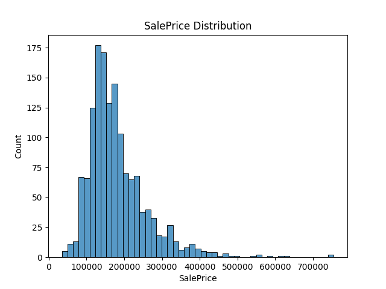 | 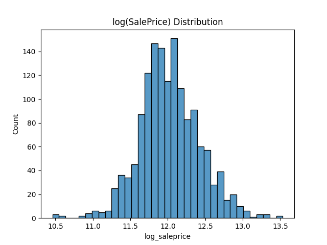 |
| 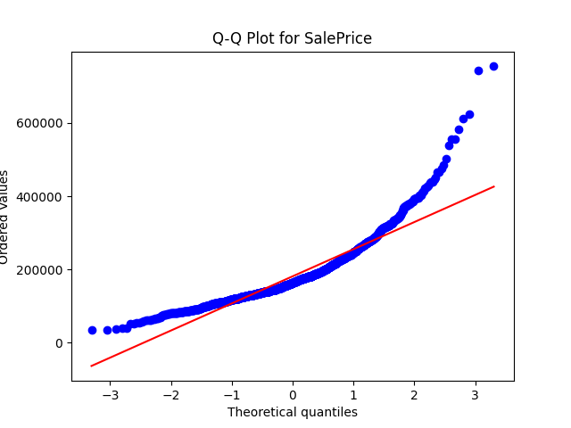 | 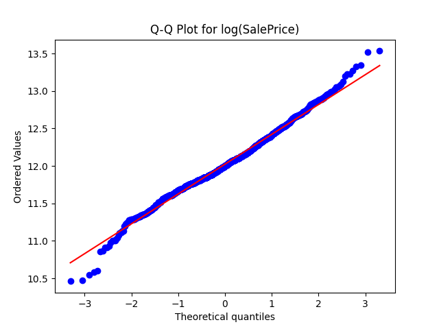 |

### Numerical Features
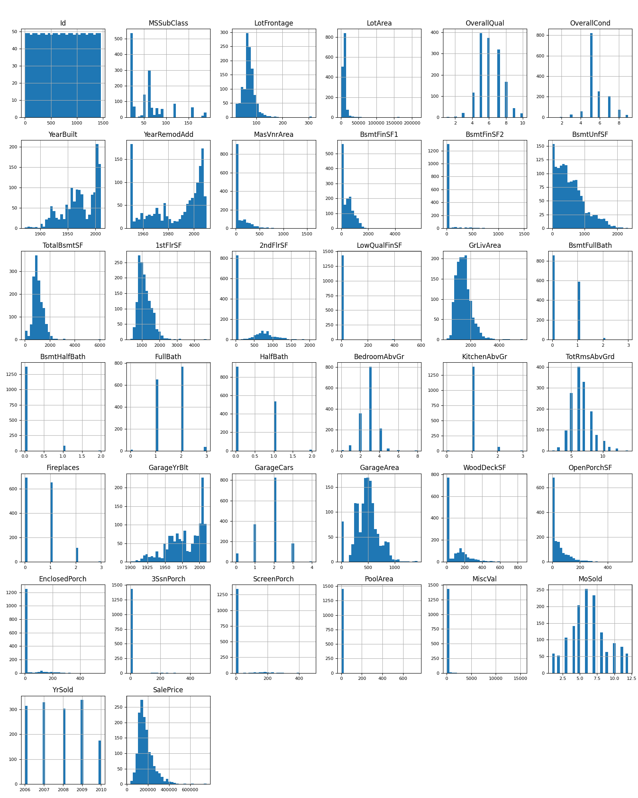

### Key Relationships with Price
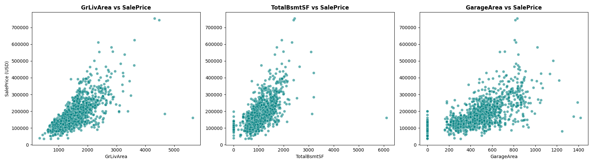

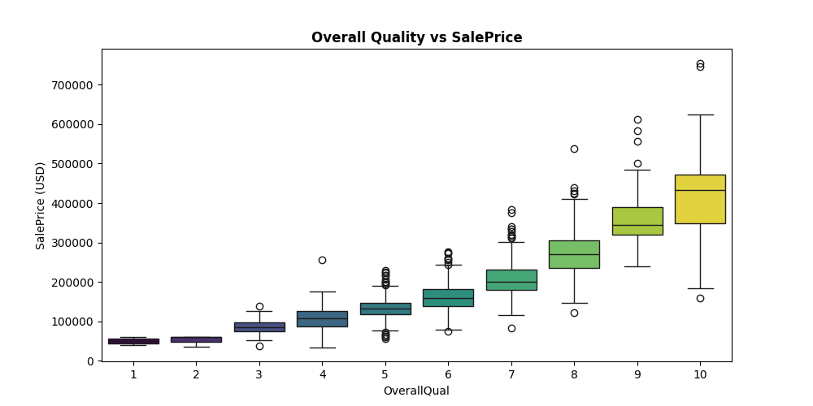

### Categorical Features
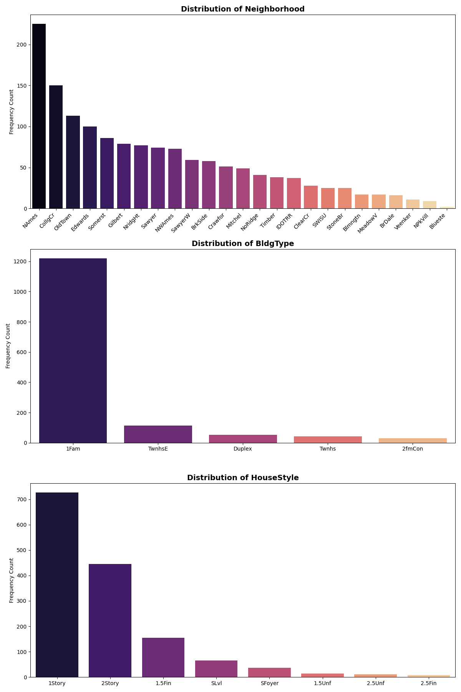

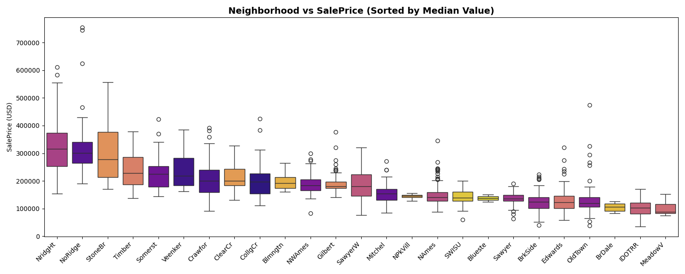

### Outlier Identification
Two rows with `GrLivArea > 4000` and `SalePrice < 300,000` were flagged and removed because they distort the fit.

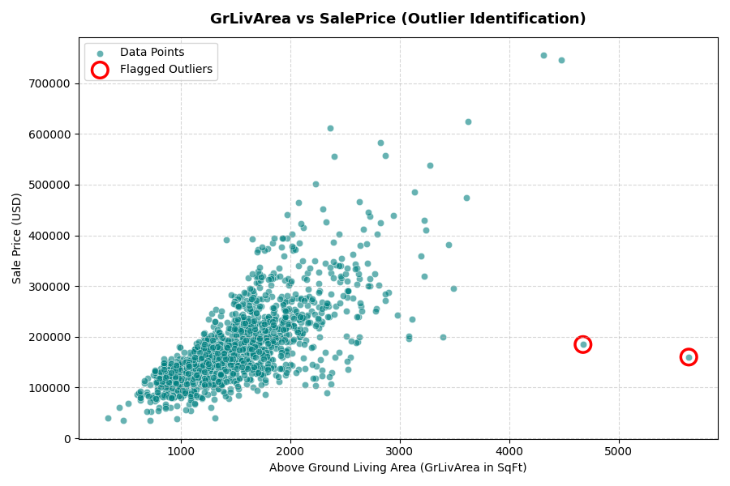

---

## 🛠️ Preprocessing & Feature Engineering
- **Target:** `log1p(SalePrice)`; predictions converted back with `expm1`. All metrics are reported in USD.
- **Missing values:** columns with >80% missing were dropped; categorical NaNs filled with `'None'` where the feature is absent (e.g. no pool or garage); numeric NaNs imputed.
- **Outliers:** 2 rows removed (see above).
- **New features:** `TotalSF`, `HouseAge`, `RemodAge`, `HasGarage`, `HasPool`.
- **Encoding & scaling:** ordinal encoding for quality columns, one-hot for low-cardinality nominal columns, `log1p` for skewed numeric features (skew > 0.75), and `StandardScaler`, all chained in a `ColumnTransformer`.
- **Split:** 80/20 train-test, `random_state=42`.

---

## 🏆 Model Results

| Model | RMSE ($) | MAE ($) | R² |
|---|---|---|---|
| **XGBoost** | **19,150** | **13,807** | **0.934** |
| Lasso | 20,073 | 14,720 | 0.927 |
| Ridge | 20,489 | 14,647 | 0.924 |
| Linear Regression | 22,620 | 15,774 | 0.907 |
| Random Forest | 23,248 | 16,309 | 0.902 |

**XGBoost** performed best. It builds trees sequentially, each correcting the previous errors, so it captures non-linear effects and feature interactions that linear models miss. Five-fold CV RMSE was `0.1232 ± 0.0077` (log scale) against a test RMSE of `0.1240`, so the result is stable. `RandomizedSearchCV` did not beat the default settings (tuned RMSE $21,079), likely because the search space allowed very deep trees that overfit a small dataset.

### Actual vs Predicted
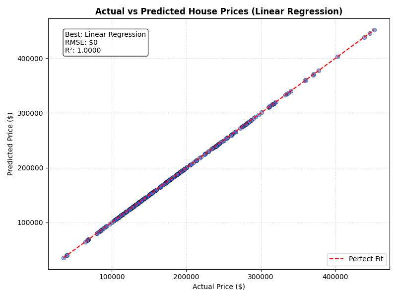

### Residual Analysis
Residuals are centred around zero and roughly normal, with the largest errors on expensive houses.

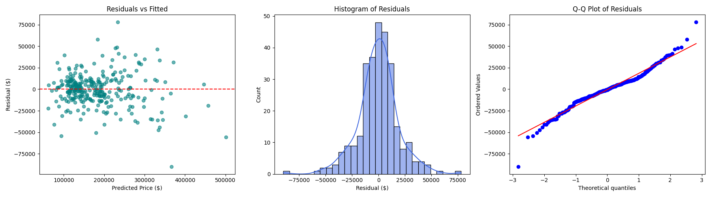

---

## ⭐ Top Predictive Features
1. **OverallQual** – build and finish quality is the strongest driver of price.
2. **TotalSF** – total area (basement + both floors) matters more than any single room count.
3. **ExterQual** – exterior material quality shapes first impressions and curb appeal.

Neighbourhood, garage capacity and central air also contribute.

---

## ▶️ How to Run

**1. Clone the repository**
```bash
git clone https://github.com/HarshalVora86/house-price-regression-supervised-learning.git
cd house-price-regression-supervised-learning
```

**2. Install dependencies**
```bash
pip install -r requirements.txt
```

**3. Add the dataset**
Download `train.csv` from Kaggle and place it at `Dataset/train.csv`.

**4. Train the model**
```bash
python train_model.py
```
This trains the pipeline, prints test-set metrics (RMSE, MAE, R²), and saves:
- `model/house_price_model.pkl`
- `model/metrics.json`

**5. Explore the notebook**
```bash
jupyter notebook Notebook/HousePrice_SupervisedLearning.ipynb
```

**6. Use the saved model**
```python
import joblib, numpy as np, pandas as pd

model = joblib.load("model/house_price_model.pkl")
new_houses = pd.read_csv("Dataset/train.csv").drop(columns=["SalePrice", "Id"]).head(3)
print(np.expm1(model.predict(new_houses)))   # predicted prices in USD
```

For the full write-up, see [`summary_report.md`](summary_report.md).

---

## 📬 Contact
**Harshal Vora**
- GitHub: [@HarshalVora86](https://github.com/HarshalVora86)
- LinkedIn: [Harshal Vora](https://www.linkedin.com/in/harshal-vora-344601251/)

⭐ If you found this project useful, consider giving the repo a star!
